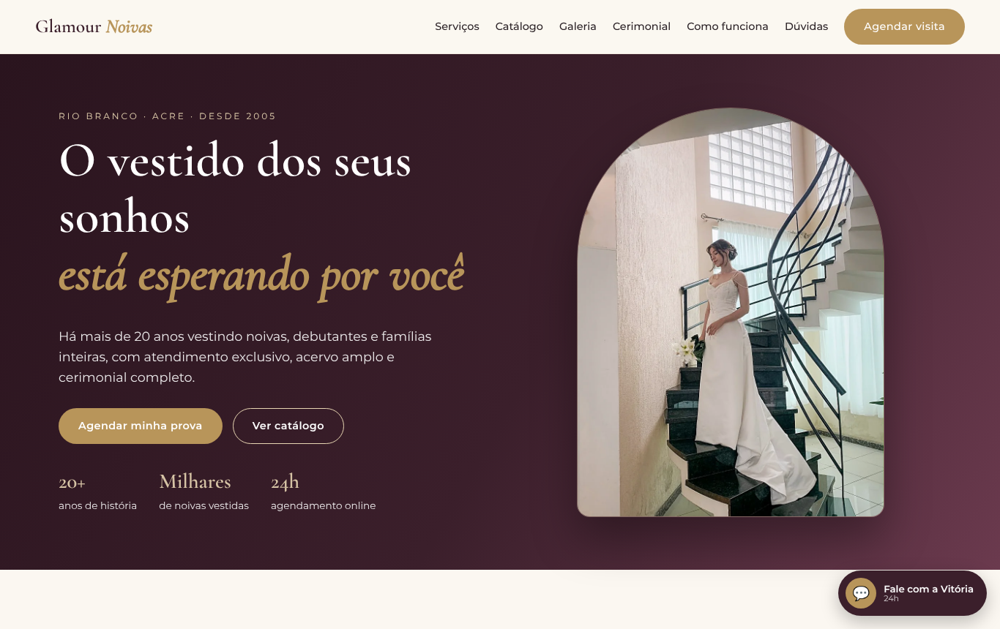
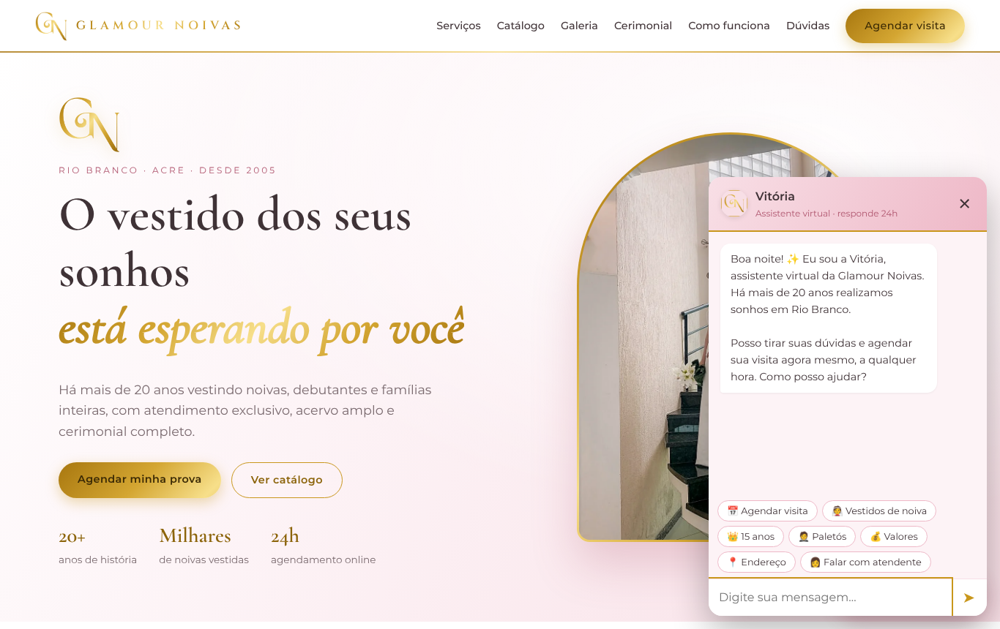
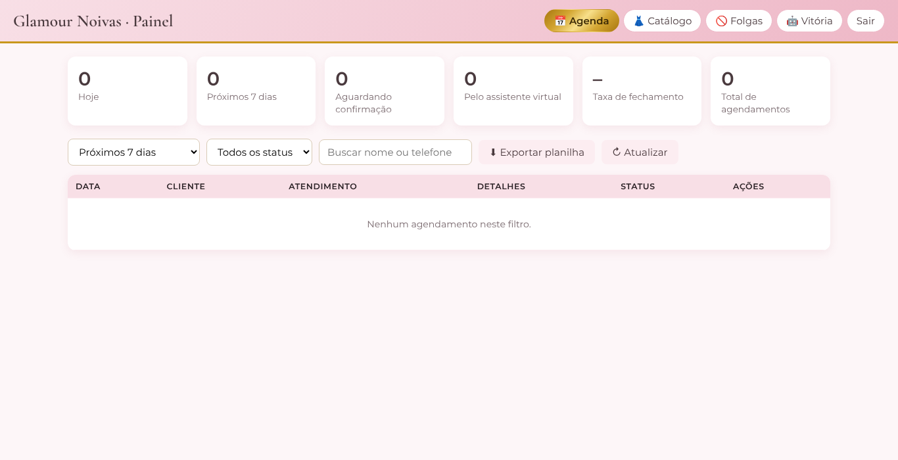
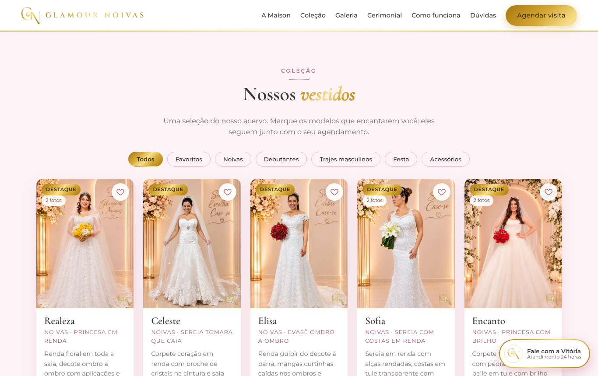
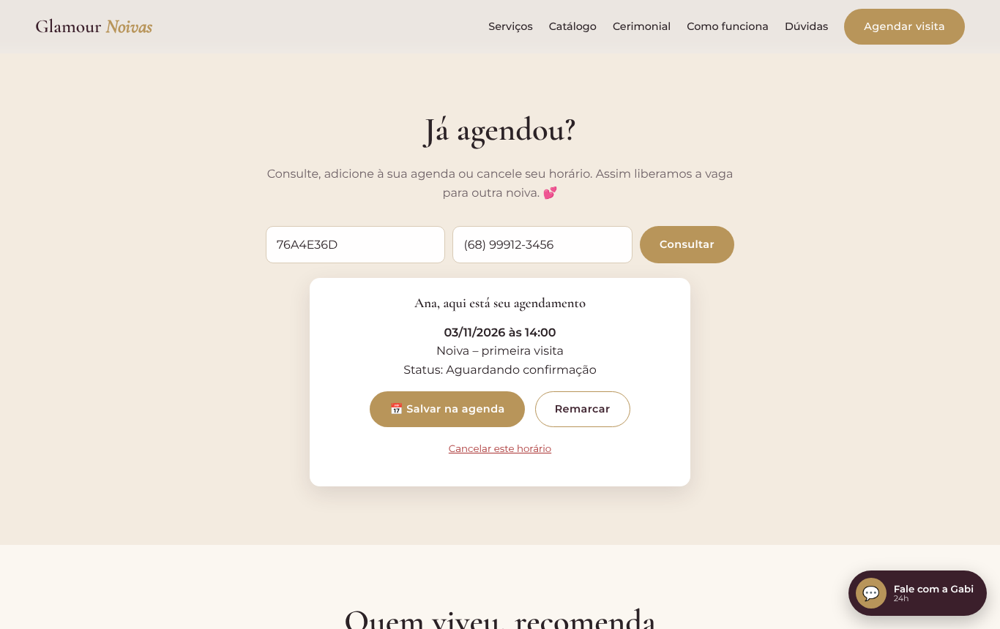
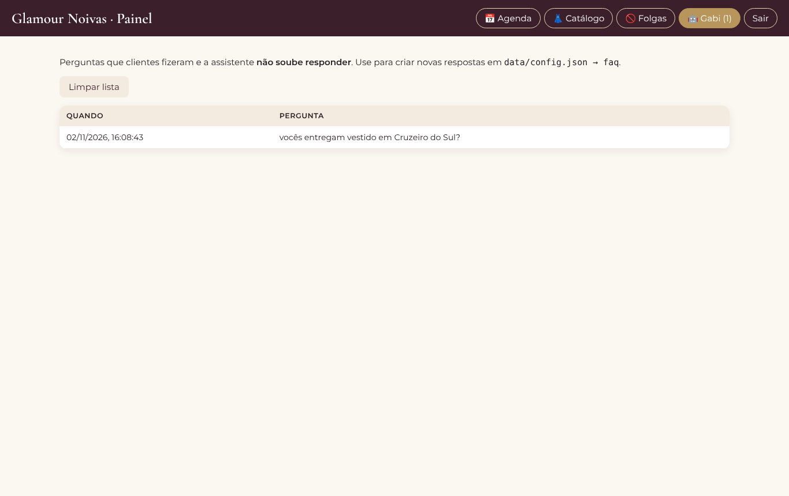
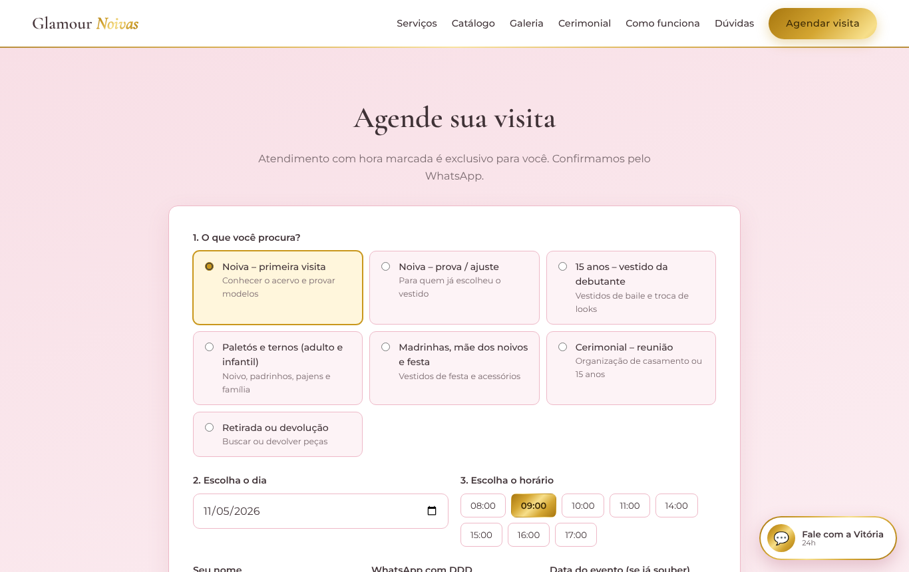
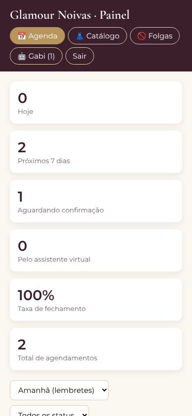

# Glamour Noivas: site, agendamento e assistente virtual

Site da Glamour Noivas (Rio Branco – AC) com:
- Catálogo com filtros e favoritos
- Agendamento online 24h com controle de vagas por horário
- Assistente virtual "Vitória", gratuita, que responde dúvidas e agenda pela conversa
- Consulta, cancelamento e "salvar na agenda do celular" pela própria cliente
- Painel da loja em `/admin`: agenda, lembretes de amanhã, contratos fechados, taxa de fechamento, catálogo, folgas e perguntas que a assistente não soube responder. Pode ser instalado no celular como aplicativo.

## Telas

| Site | Assistente / Cliente | Painel |
|---|---|---|
|  |  |  |
|  |  |  |
|  |  |  |

Não depende de nenhuma biblioteca externa. Só precisa do **Node.js 18 ou mais novo**.

## Rodar no computador

```bash
node server.js
```

Abra http://localhost:3000. O painel fica em http://localhost:3000/admin (senha padrão `glamour2026`).

## ⚠️ Antes de publicar: troque estes dados

| Onde | O quê |
|---|---|
| `data/config.json` → `loja` | **WhatsApp** (formato `5568999999999`), endereço, link do Maps, horário |
| `data/config.json` → `agenda` | horários de funcionamento, duração de cada atendimento, quantas clientes atende ao mesmo tempo, feriados |
| `data/config.json` → `depoimentos` | depoimentos reais (copie do Instagram/Google) |
| `data/config.json` → `faq` | respostas da assistente (as `chaves` são as palavras que ativam cada resposta) |
| Painel → Catálogo | peças reais. Coloque as fotos em `public/img/` e preencha `img/nome-da-foto.jpg` |
| `public/img/hero.svg` | troque por uma foto real de noiva (ex.: `hero.jpg`) e ajuste em `public/css/style.css` |
| Variável `ADMIN_PASSWORD` | **senha forte do painel** |

## Publicar no Railway (passo a passo)

1. Em https://railway.com, entre com a conta do GitHub → **New Project** → **Deploy from GitHub repo** → escolha `glamour-noivas`.
   Se o repositório não aparecer: **Configure GitHub App** → dê acesso ao repositório `glamour-noivas`.
2. No serviço criado, abra **Variables** e adicione:
   - `ADMIN_PASSWORD` = uma senha forte para o painel
   - `DATA_DIR` = `/data`
3. **Disco permanente (obrigatório):** clique com o botão direito no serviço (ou `Ctrl/Cmd + K`) → **Add Volume** → *Mount path* `/data`.
   Sem o volume, **os agendamentos são apagados a cada nova publicação**.
4. Em **Settings → Networking → Generate Domain** você recebe um endereço `....up.railway.app`. Esse já é o site no ar.
5. Teste: abra o endereço, faça um agendamento e confira em `/admin`.
6. (Opcional) Domínio próprio: **Settings → Networking → Custom Domain** e o apontamento no registro.br.

Ao mudar algo no GitHub, o Railway publica de novo sozinho. Os dados do volume são mantidos.

**O que fica onde:**
- `data/config.json` (no GitHub): WhatsApp, endereço, horários e respostas da Vitória. Edite aqui e publique.
- Volume `/data`: agendamentos, catálogo editado pelo painel, folgas e perguntas. Muda com o uso e nunca é apagado.

### Outras opções
VPS (Hostinger, Contabo, Oracle Cloud *Always Free*): `ADMIN_PASSWORD=suaSenha DATA_DIR=/var/glamour PORT=80 node server.js`, de preferência com `pm2` e HTTPS.

## Estrutura

```
server.js            servidor e API
data/config.json     dados da loja, agenda, FAQ da assistente
data/catalogo.json   peças do catálogo
data/agendamentos.json
public/index.html    site
public/admin.html    painel
public/js/chat.js    assistente virtual
public/js/app.js     catálogo e agendamento
```

Veja **PLANO-ESTRATEGICO.md** (plano de crescimento) e **docs/KIT-EXECUCAO.md** (bio, WhatsApp, Google e calendário de posts prontos).

## Domínio glamournoivasac.com.br

O servidor já redireciona `www` → `glamournoivasac.com.br` e `http` → `https` (pode mudar com a variável `DOMINIO`).
Ligação: Railway → serviço → Settings → Networking → **Custom Domain** para `glamournoivasac.com.br` e `www.glamournoivasac.com.br`;
o Railway mostra os registros DNS (CNAME e TXT de verificação) a criar. Como o DNS do Registro.br não aceita CNAME no domínio raiz,
use o Cloudflare (grátis) como DNS: ele faz o "CNAME flattening" no domínio raiz.

## Fotos e marca d'água

- `originais/vestidos/`: fotos tratadas **sem** logo (não aparecem no site; servem para refazer a marca).
- `public/img/vestidos/`: fotos publicadas, **com** o monograma GN no canto inferior direito.
- Para marcar fotos novas: coloque a versão tratada em `originais/vestidos/` e rode
  `python3 ferramentas/marca-dagua.py` (precisa de Python com Pillow e NumPy).
  Cada foto precisa da versão `-card.webp` (retrato 3:4), usada no catálogo e na galeria.

## Financeiro (contador virtual)

Aba **Financeiro** do painel: lançamentos (contas a pagar e a receber), contratos com parcelas automáticas e bloqueio de peças por data,
acervo como patrimônio (custo, depreciação, retorno por peça), DRE, balanço patrimonial, fluxo de caixa projetado, simulador e backup.
Os dados ficam em `fin-*.json` na pasta de dados (volume `/data` no Railway).
